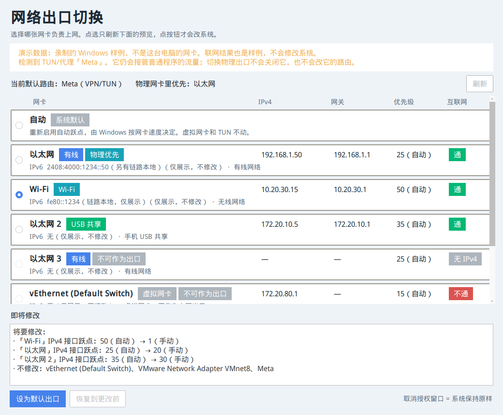
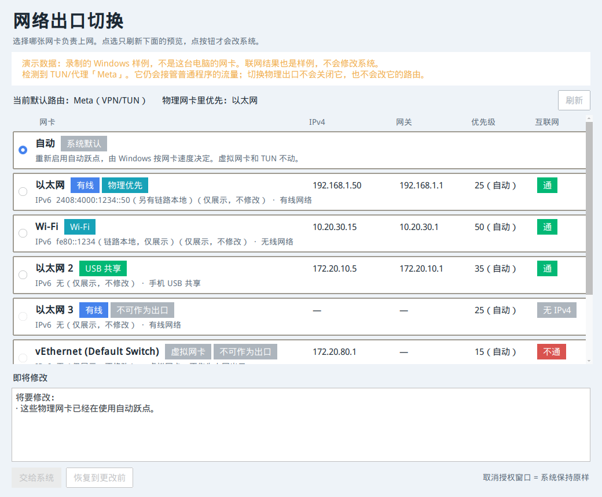

# 网络出口切换

在 Windows、macOS 和 Ubuntu 上看清每一张网卡，并在你点过按钮之后，把其中一张设成 IPv4 默认出口。适合在有线、Wi-Fi 和手机 USB 共享之间切换。

校园网只使用 IPv4。IPv6 地址会显示，但不会被修改。



上图来自录制的 Windows 样例，窗口里写了「演示数据」。它不是这台电脑的网卡，也不会修改系统。选中「自动」时，如果物理网卡已经在用自动跃点，预览会说明没有要改的项目：



## 它改什么

| 系统 | 做法 |
| --- | --- |
| Windows 10/11 | `Set-NetIPInterface` 调 IPv4 接口跃点；这条失败再用 `netsh` |
| macOS | `networksetup -ordernetworkservices`，把选中的服务放到第一位 |
| Ubuntu | NetworkManager 的 `ipv4.route-metric`；不管这张网卡时用 `ip route` |

点选一张网卡只刷新预览。点「设为默认出口」或「恢复到更改前」之后，才会弹出 UAC、管理员密码或 `pkexec`。取消授权则什么都不改。第一次修改前的状态会记下来，恢复始终回到那一版。

有系统托盘或菜单栏图标时，里面的「准备切换」只会把主窗口里的预览选好，仍然要点按钮。Linux 上如果没有 Gtk / AppIndicator，托盘会自动停用，窗口照常使用。

「自动」在 Windows 上重新打开自动跃点，在 Ubuntu 上把 metric 设回 `-1`，在 macOS 上恢复第一次切换前的服务顺序。

不要用管理员身份启动整个窗口。命令行可以：

```bash
egress-switcher list
egress-switcher set "Wi-Fi"          # 只打印预览，退出码 3
egress-switcher set "Wi-Fi" --yes    # 确认后才改
egress-switcher restore --yes
egress-switcher automatic --yes
```

## 和 TUN、虚拟网卡

mihomo / Clash Meta、sing-box、游戏加速器的 TUN，以及 VMware、Hyper-V，会被认出来并标成不可作为出口。程序不改它们的跃点，也不关闭它们。

TUN 开着时，普通程序的流量仍会进 TUN。切换物理网卡通常只影响代理自己用哪张网卡出去，以及没有走 TUN 的程序。

## 开发

需要 Python 3.10 或更新版本。

```bash
python3 -m venv .venv
source .venv/bin/activate
pip install -e ".[gui]"
python -m unittest discover -s tests -v
egress-switcher --demo
```

`--demo` 使用 `src/egress_switcher/fixtures/` 里录制的 `route print`、`Get-NetIPInterface`、`netstat -rn`、`networksetup`、`ip route` 和 `nmcli` 输出。

真机上要自己验收的步骤在 [docs/HARDWARE_CHECKLIST.md](docs/HARDWARE_CHECKLIST.md)。

## 打包

推送 `v*` 标签后，GitHub Actions 会打出：

| 系统 | 文件 |
| --- | --- |
| Windows | `net-egress-switcher-windows.zip` |
| macOS Apple Silicon / Intel | `net-egress-switcher-macos-apple-silicon.dmg` 和 intel 对应包 |
| Ubuntu / Debian | `net-egress-switcher_<版本>_all.deb` |

本地：

```bash
python build.py                         # 当前系统上的 PyInstaller 程序
bash scripts/linux/build_deb.sh         # .deb
bash scripts/macos/build_app.sh         # 只能在 macOS 上打 .app / .dmg
```

macOS 包是临时签名，没有公证。
